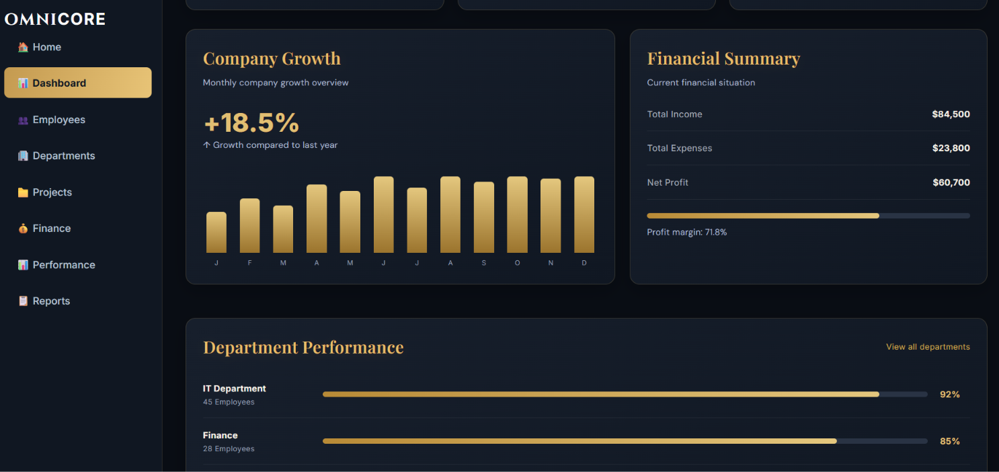
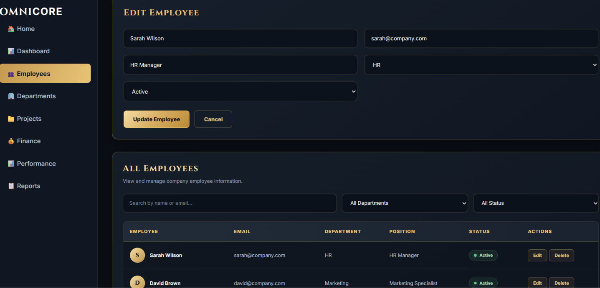
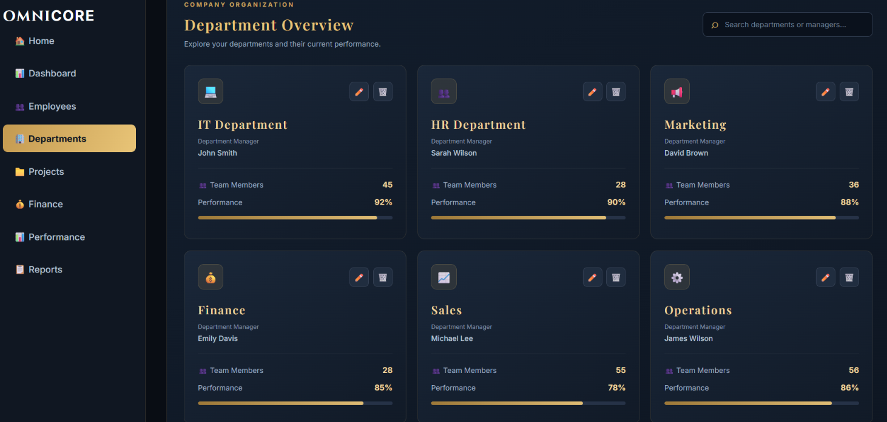
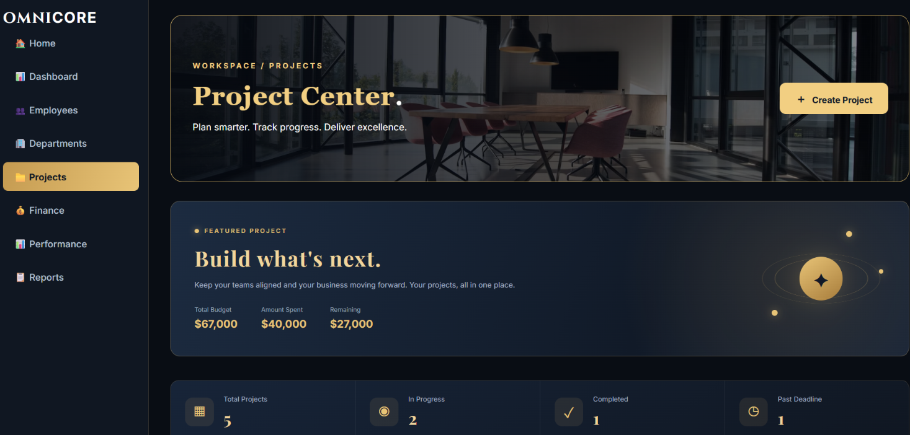
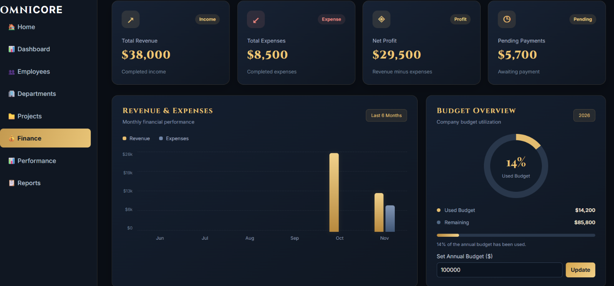
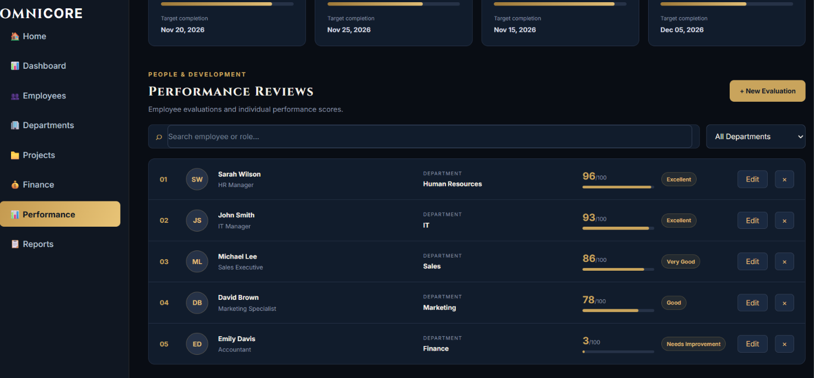
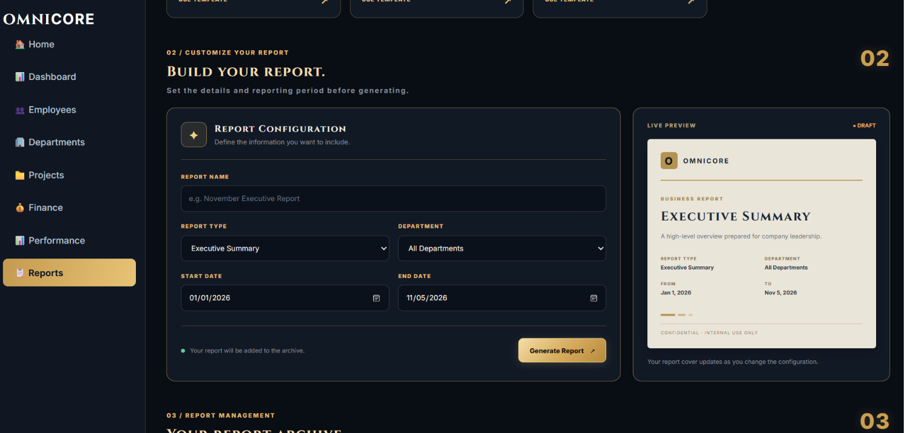
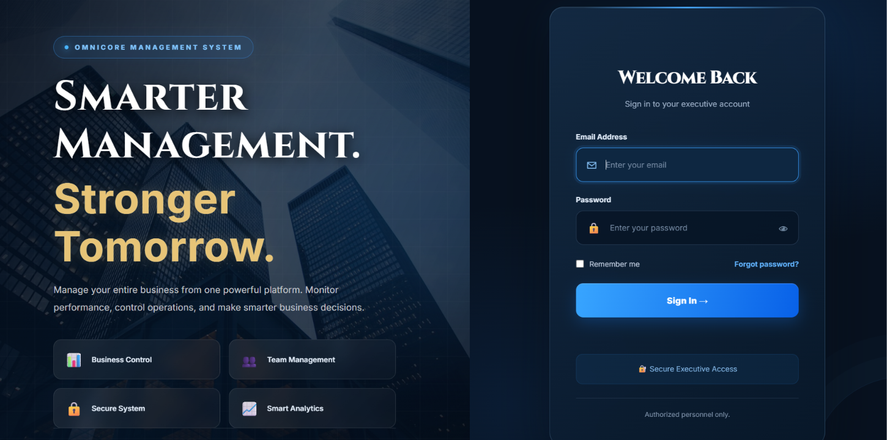

# Omnicore Management System

## Project Overview

Omnicore Management is a web-based company management system developed using React.js. It provides a centralized dashboard that helps administrators manage company operations and monitor different business activities.

## Main Features

### 1. Home
- Main welcome page.
- Navigation to the system sections.

### 2. Dashboard
- Displays company statistics.
- Shows total employees, revenue, expenses, and net profit.
- Displays active projects and pending tasks.
- Provides an overview of company performance.

### 3. Employees Management
- Add new employees.
- Edit employee information.
- Delete employees.
- Search and filter employees.
- Manage employee departments and status.

### 4. Departments Management
- View company departments.
- Add, edit, and delete departments.
- Track department information and performance.

### 5. Projects Management
- Create and manage projects.
- Track project progress.
- Monitor budgets and deadlines.
- View project details and status.

### 6. Finance Management
- Manage income and expenses.
- Track financial transactions.
- View revenue, expenses, and net profit.
- Monitor the company budget.

### 7. Performance
- Monitor employee performance.
- Review performance scores.
- View department performance.

### 8. Reports
- Generate company reports.
- View employee, department, project, and financial reports.
- Search and filter reports.

## Technologies Used

- React.js
- JavaScript
- HTML5
- CSS3
- React Router
- Create React App
- GitHub Pages


## Live Website

https://waed33.github.io/My-company

## Developer

Omnicore Management System
## Setup Instructions

Follow these steps to set up and run the Omnicore Management System on your computer.

### Prerequisites
Before starting, make sure you have installed:
- Node.js
- npm (Node Package Manager)
- Visual Studio Code
- Git (if you want to clone the project)

### Step 1: Download the Project
Clone the repository using:

```bash
git clone https://github.com/waed33/My-company.git
```

Or download the project as a ZIP file and extract it.

### Step 2: Open the Project
Open Visual Studio Code, select **File → Open Folder**, and choose the project folder containing `package.json`.

### Step 3: Install Dependencies
Open the VS Code terminal and run:


npm install


This command installs all required project dependencies.

### Step 4: Run the Application
Start the development server:


npm start


The application will open in your browser at:

http://localhost:3000

### Step 5: Build the Application
To create an optimized production version, run:


npm run build


The production files will be generated inside the `build` folder.

### Step 6: Deploy to GitHub Pages
To publish the application, run:


npm run deploy


The application will be deployed to:

https://waed33.github.io/My-company


## Screenshots

### Home Page


### Dashboard


### Employees


### Departments


### Projects


### Finance


### Performance


### Reports


### Login
